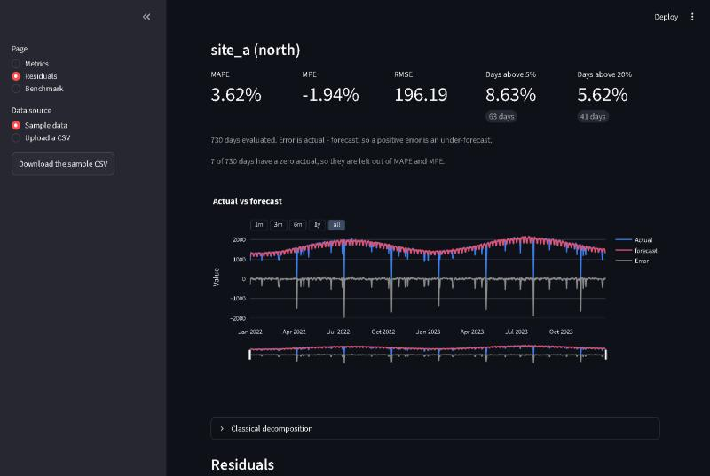

# Forecast error analysis

[](https://github.com/jvitorcosta/timeseries-analysis-streamlit/actions/workflows/ci.yml)

[](LICENSE)
[](https://forecast-error-analysis.streamlit.app)

A single MAPE number says a forecast is "5% off". It doesn't say **where**: which series,
which weekdays, which holidays, or whether a simpler baseline would have done better.
This app answers those questions for daily forecasts.

I first built it in 2022 for daily demand forecasting, to compare candidate models against
the incumbent forecast, series by series and day by day. This version is a rebuild on a
current stack, with tested metrics and a synthetic sample dataset.

**[Try the live demo](https://forecast-error-analysis.streamlit.app)**. It loads the sample data, so there is nothing to upload. The app may sleep when idle and take a moment to wake.



## What it shows

**Metrics**
- Share of days above a 5% or 20% tolerance, per series and for each group's daily total.
- MAPE and RMSE, per series and per group total, over any chosen period.

**Residuals**
- Actual vs forecast, error over time, and standardized residuals, per series.
- Error and APE by month and weekday, RMSE by month and weekday, and the worst days.
- Classical decomposition of the actual, forecast or error, with a 7, 30 or 365-day period.
- ACF and PACF of the errors and squared errors, with lags in calendar days.
- Error on holidays across all series, using a Brazilian and São Paulo calendar that
  includes moving dates such as Carnival and Corpus Christi.

**Benchmark**
- Several forecasts scored on exactly the same rows, for a group total or one series.
- Colour-coded daily tables of signed percentage error.
- An optional hybrid that takes each series from a forecast you choose. It's scored on the
  same data, so it describes the past and doesn't show how it would do on new data.

## Metrics

Error is always `actual - forecast`, so a positive error is an under-forecast.

| Metric | Definition | Notes |
|---|---|---|
| Percentage error | `100 * (actual - forecast) / actual` | Undefined on a zero actual |
| MAPE | Mean of the absolute percentage error | Skips zero actuals and shows how many |
| MPE | Mean of the percentage error | Positive means the forecast runs low |
| RMSE | Root mean squared error | |
| Deviation from forecast | `100 * \|actual - forecast\| / \|forecast\|` | Drives "days above tolerance" |
| Standardized residual | `(error - mean) / standard deviation` | Needs 3 days with different errors |

Tolerance divides by the forecast on purpose: it asks how far the outcome landed from what
was planned. A forecast of zero that misses counts as above any tolerance. MAPE divides by
the actual, so the two can disagree on the same day.

Forecasts are scored as given, with no clipping or cap. Group views score the daily total
of the group, so opposite errors in its series can net out.

## Input format

One row per series per day. Pick the column names in the sidebar after uploading. The app
guesses common ones.

| Column | Example | Purpose |
|---|---|---|
| series id | `site_a` | the series being forecast |
| date | `2022-03-01` | day, in ISO format |
| actual | `1520.4` | observed value |
| forecast | `1498.0` | the model being evaluated |
| benchmarks (optional) | `1610.2` | other forecasts to compare against |
| group (optional) | `north` | a grouping for aggregated views |

Rows without an actual or forecast are left out and counted. The app opens on a seeded,
fully synthetic sample, which you can download to see the format.

## Run it

You need [uv](https://docs.astral.sh/uv/) and `make`.

```bash
make install
make run
```

## Development

```bash
make check
```

This runs ruff, mypy in strict mode, and pytest with coverage. The tests include headless
runs of every page with Streamlit's AppTest.

The code lives in `src/forecast_eval/`: `core/` holds the calculations, `charts/` builds
Plotly figures, and `ui/` holds the Streamlit pages. `core/` and `charts/` don't import
Streamlit, and a test enforces it. To rebuild the sample, run
`uv run python scripts/make_sample_data.py`.

## License

[MIT](LICENSE)
